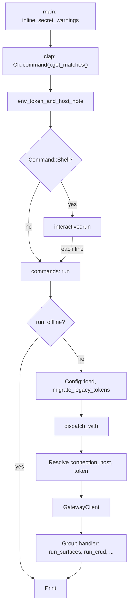

# Architecture

How the Affinidi Trust Fabric CLI is put together, and where in `src/` each part lives.

This page is for contributors changing the code. For what the CLI does and how to use it,
start with the [`README.md`](README.md) and the [user documentation](docs/README.md). For
the rules a change must follow, use [`CONTRIBUTING.md`](CONTRIBUTING.md).

## System shape

The CLI is one Rust binary, `fabric`, built from [`src/`](src/). There is no library
target: [`Cargo.toml`](Cargo.toml) declares a single `[[bin]]` whose entry point is
[`src/main.rs`](src/main.rs). Arguments are defined with clap's derive API.

Every command is addressed to an appliance first. Today there is one,
`agent-gateway`, so a command line reads `fabric agent-gateway <group> <command>`. The
CLI talks to the gateway's management API over HTTP; it has no server component of its
own, apart from the short-lived loopback listener used during browser login.

| Concern | Where it lives |
| --- | --- |
| Command definitions, help text, and handlers | [`src/commands.rs`](src/commands.rs) |
| Saved connections (name and host) | [`src/config.rs`](src/config.rs), in `config.toml` |
| Tokens | [`src/credentials.rs`](src/credentials.rs), in the OS credential store |
| HTTP to the gateway | [`src/client.rs`](src/client.rs) |
| Output | [`src/tables.rs`](src/tables.rs) and the print helpers at the end of `commands.rs` |
| Surface editing | [`src/features.rs`](src/features.rs), [`src/surface_patch.rs`](src/surface_patch.rs), [`src/surface_validate.rs`](src/surface_validate.rs), [`src/tool_gate_preview.rs`](src/tool_gate_preview.rs) |

`commands.rs` is by far the largest file. Most changes land there.

## State and storage

The CLI keeps two pieces of local state, and keeps them apart.

| State | Where | Notes |
| --- | --- | --- |
| Connections | `fabric/config.toml` under the user configuration directory (`dirs::config_dir`), so `~/Library/Application Support/fabric/config.toml` on macOS, `$XDG_CONFIG_HOME/fabric/config.toml` on Linux, and `%APPDATA%\fabric\config.toml` on Windows | `Config` holds the `current` connection name and a map of named `Connection`s, each just a `host`. On Unix the file is written owner-only (`0600`). |
| Tokens | The OS credential store, through the `keyring` crate: macOS Keychain, Windows Credential Manager, or Linux Secret Service (over D-Bus with the pure Rust `zbus` client, so the binary does not link `libdbus`) | The service name is `affinidi-trust-fabric-cli`. The account is the connection name. The host the token was issued for is kept beside it under `<name>#bound-host`. |

Because the bound host shares the account namespace, `login` refuses a connection name
containing `#`, and `Config::hash_name_warnings` warns about any such name already saved.

Older versions wrote the token into `config.toml`. `Connection` still reads that `token`
field (into `legacy_token`) but never writes it, and `Config::migrate_legacy_tokens` moves any token
it finds into the credential store, records its bound host, and rewrites the file
without it. This runs on every command that reaches `dispatch` and is not handled by
`run_offline`.

## The life of a command

### Argument parsing

[`main.rs`](src/main.rs) does three things before any command runs.

1. `inline_secret_warnings` scans the raw arguments for a secret typed on the command
   line (`--token`, `--pat`, `--value`, `--password`) and prints a `warning:` for each,
   naming the safer source to use instead. It stops at `--`.
2. clap parses the arguments into `Cli`. The tree is `Cli` → `Appliance` (one variant,
   `AgentGateway`) → `AgentGatewayArgs` → `Command`.
3. `env_token_and_host_note` prints a `note:` when both the token and the host came from
   environment variables (`FABRIC_TOKEN` and `FABRIC_HOST`), so the two do not meet
   silently. It runs once per process, here, rather than inside `run`, because the
   interactive shell passes its host and token to every line as typed flags.

`AgentGatewayArgs` holds the global flags every command shares:

| Flag | Environment | Purpose |
| --- | --- | --- |
| `--connection`, `-c` | `FABRIC_CONNECTION` | Which saved connection to use, or which to save on `login` |
| `--host` | `FABRIC_HOST` | Override the saved host for this command |
| `--token` | `FABRIC_TOKEN` | Override the saved token for this command |
| `--allow-http` | none | Allow plain `http://` to a host that is not loopback |
| `--allow-host-override` | none | Send the saved token to a host other than the one it is bound to |
| `--output`, `-o` | none | `table` (default) or `json` |

`Command` is the list of command groups. Each group is a variant carrying its own
subcommand enum (`SurfaceCommand`, `PolicyCommand`, `SecretCommand`, and so on), or the
shared `CrudCommand`.

### Resolving the connection, host, and token

`run` calls `dispatch`, which first tries `run_offline` for commands that need no
connection at all (today, `surfaces tool-gate-preview --gates-file`). Otherwise it
creates the real `OsCredentialStore`, loads `Config`, migrates any plaintext legacy
tokens into the credential store, and calls `dispatch_with`, which takes the config and
a `&impl CredentialStore` as arguments so tests can supply both. The migration is
skipped when `skips_the_credential_store` says the command was given both a host and a
token and is not `login`, `logout` or `config`, because such a command never reads the
credential store, so a server with no desktop session never reaches the keyring.

`dispatch_with` first handles the commands that do not take the shared path below
(`login`, `logout`, `config`, `whoami`, and the feature list with no surface). For every
other command, and for `whoami`, `command_target` picks the host and token:

1. With no `--connection` and no `current` connection, and both a `--host` and a
   `--token` (typed or from `FABRIC_HOST` and `FABRIC_TOKEN`), it uses those two as they
   are, after `normalize_user_host`, and never touches the credential store.
2. Otherwise it resolves the connection with `Config::resolve`: the `--connection`
   value, else the `current` one.
3. It picks the host with `command_host`: a `--host` value goes through
   `normalize_user_host`, which refuses plain `http://` to a non-loopback host unless
   `--allow-http` is set; otherwise the saved host is used, with a warning (once per
   host per process) if it is plain `http://` to a remote machine.
4. It picks the token: `--token` if given, without opening the credential store; otherwise `check_token_host` confirms the host
   matches the connection's bound host, and the token is read from the credential store.
   A mismatch is refused unless `--allow-host-override` was typed. For a connection
   saved before bound hosts existed, the saved host is recorded as the bound host on
   first use.

The command then builds a `GatewayClient` for that host and token. On Linux, `dispatch`
passes any error from `dispatch_with` through `add_no_keyring_hint`, which adds a hint
naming `FABRIC_HOST` and `FABRIC_TOKEN` when a Secret Service call failed because there
is no D-Bus session or the message bus answered `ServiceUnknown`. A running keyring that
refuses a call gets no hint. The legacy token migration runs before `dispatch_with` and
reruns on every command that may use the store, so it adds its own hint through
`add_no_keyring_migration_hint`: copy the plaintext `token` value into `FABRIC_TOKEN`,
delete that line from `config.toml`, and set `FABRIC_HOST` too.

### The HTTP client

`GatewayClient` in [`client.rs`](src/client.rs) wraps one `reqwest::Client` built by
`build_http_client`, which the browser login shares.

| Setting | Value | Constant |
| --- | --- | --- |
| Connect timeout | 10 s | `CONNECT_TIMEOUT` |
| Inactivity (read) timeout | 120 s | `READ_TIMEOUT` |
| Whole-request timeout | 300 s, on every call except the log archive download and the version request | `TOTAL_TIMEOUT` |
| Version request timeout | 10 s, on the gateway version request `whoami` makes | `VERSION_TIMEOUT` |
| Redirects | At most 5, and only to the same origin; any other redirect is not followed and the 3xx is reported | `MAX_REDIRECTS`, `same_origin_redirects` |
| User agent | `affinidi-trust-fabric-cli/<version>` | `build_http_client` |

Paths are relative to the gateway's `/api` prefix: `GatewayClient::url` adds `/api`
unless the path already starts with `/api/`, and refuses a path that does not start with `/`
or that contains a `..` or `.` segment, a backslash, a control character, or an encoded
slash, after repeated percent-decoding (`has_unsafe_segments`).

The request methods are:

| Method | Use |
| --- | --- |
| `request` | JSON in, JSON out, bearer token. An empty body becomes `null`. |
| `get_with_headers` | `GET`, also returning response headers (used to detect surface dry-run support) |
| `merge_patch` | `PATCH` with `application/merge-patch+json`, which the gateway's surface routes require |
| `request_bytes` | Non-JSON success bodies, such as the Prometheus exposition; bearer or HTTP Basic (`RawAuth`) |
| `download_bytes` | The log archive, with only the inactivity timeout applied |
| `check_auth`, `check_pat_auth`, `end_session` | Login validation and logout |
| `gateway_version` | The gateway's version from the public `/v1/version` route, sent without the token and held to `VERSION_TIMEOUT` (10 s). An answer over `MAX_VERSION_BODY_BYTES` (4 KiB) is refused; from the version text only ASCII letters, digits, `.`, `-` and `+` are kept, cut to 64 characters. A non-200 answer keeps its status for `response_status`, so `whoami` can stay quiet on a 404 and warn on anything else |

A non-success status becomes a `GatewayStatusError` built by `gateway_error`. It picks
the reason out of the known error body shapes (`message`, or `error` with `details`),
prefers the gateway's own wording when the body names a `required_permission`, and
keeps the status so a caller can branch on it with `response_status`. Before any
gateway text reaches the terminal, the credentials the request carried
(`GatewayClient::secrets`) are replaced with `[redacted]`, and the text is passed
through `sanitize_for_terminal`, which strips control and bidirectional characters,
folds line breaks, and caps the length. `sanitize_whole` and `sanitize_multiline` are
the uncapped and multi-line variants.

### Dispatch to handlers

After the client is built, `dispatch_with` does some per-command preparation, then calls
the group's handler:

- `resolve_surface_command` swaps a surface name for its ID in every surface command
  that names one, printing `note: using surface <id> (<name>)` to standard error.
- `create_kind`, `delete_confirmation`, `update_confirmation`, `list_layout`, and
  `list_scope` read the command before it is consumed, to decide how the result prints.
- The handler runs: `run_crud` for resources that fit the shared CRUD shape, or a
  group-specific function such as `run_surfaces`, `run_secrets`, `run_policies`, or
  `run_api`.

Handlers return in one of three ways:

| Return | Meaning | Examples |
| --- | --- | --- |
| `Result<Value>` | The shared printer prints it | `run_crud`, `run_policies`, `run_users` |
| `Result<Option<Value>>` | `None` means the handler already printed its outcome | `run_surfaces`, `run_secrets`, `run_certificates` |
| `return` from `dispatch_with` | The handler prints everything itself | `run_audit`, `run_payments`, `run_metrics`, `run_logs`, `run_api_keys`, `run_access_tokens` |

`run` wraps every error with `add_terms_hint`, because the gateway's Terms of Use gate
can refuse any route.

### Output

Standard output carries the result. Standard error carries everything else, with a
fixed prefix.

| Prefix | Meaning |
| --- | --- |
| `note:` | Information, such as which surface a name resolved to |
| `warning:` | Something the user should act on, but the command continues |
| `error:` | The command failed. Printed by `main` (or by the shell for one line) as `error: {error:#}`, so the whole `anyhow` context chain shows. |

In `dispatch_with`, a value is printed by one of three paths:

- A delete or update with a confirmation prints one line from `confirmation_line`, such
  as `Deleted issuer 'i-1'`, through `print_outcome`.
- A list with a layout prints through `print_list`, which renders a `tables::Layout`
  with `tables::render_scoped`.
- Anything else goes through `print_created_or_value`: `print_issued` for a create, else
  `print_value`.

With `--output json`, these print the gateway's document. The shared printer,
`print_value`, uses `pretty_json_for_terminal`, which escapes characters a terminal
could act on while keeping the JSON valid. A create or rotate whose answer carries a
secret shown once prints that secret alone on standard output, so `$(...)` captures just
the secret, and the confirmation and a `note:` on standard error.

[`tables.rs`](src/tables.rs) is the one table format. A `Layout` names its empty-list
line and its columns; a `Column` names its header, the dotted paths to try in a row, and
its width cap. Identifier columns (`whole`, `id`) are never cut short, because people
copy them into the next command. Every cell is passed through `table_cell` or
`whole_cell`.

The exit status comes from `exit_code`: `1` for a failed command, and
`INCOMPLETE_DRY_RUN_EXIT_CODE` (`3`) for a `--dry-run` whose gateway checks did not run.
clap's own exit status for an invalid command line is `2`.

### Interactive shell

[`interactive.rs`](src/interactive.rs) runs `fabric agent-gateway shell` with
`rustyline`. `Cli::interactive_prefix` captures the global flags the shell was started
with; each line is split with `shell_words`, appended to that prefix, and parsed by the
same `Cli`, so every command is available in the shell without extra wiring. Each parsed
line goes through `commands::run`, the same path as a one-shot command.

The shell runs `inline_secret_warnings` on every line and keeps a line that triggers one
out of its history. `login --paste` prompts without echo. Warnings that would repeat on
every line, such as the plain-http warning for a saved host, are shown once per process through
`first_warning_for` and the `WARNED_ONCE` list in `commands.rs`.

### Browser login

[`browser_login.rs`](src/browser_login.rs) implements loopback redirect with PKCE
(RFC 8252). `browser_login`:

1. Binds a listener on `127.0.0.1` on a free port.
2. Generates a random verifier and state, and the S256 challenge.
3. Opens `<host>/api/auth/cli/authorize?port=…&state=…&challenge=…` in the browser, and
   prints the URL in case the browser did not open.
4. Waits up to `CALLBACK_TIMEOUT` (300 s) for a request to `/callback`, refusing a state
   mismatch.
5. Exchanges the code and verifier at `<host>/api/auth/cli/exchange` for the session
   token, with a client from `build_http_client` and the `TOTAL_TIMEOUT` limit.

The token never appears in a browser URL. `acquire_login_token` in `commands.rs` decides
whether browser login runs at all: an explicit token, `--pat`, `--token-stdin`,
`--paste`, or piped standard input each take precedence. `login_and_save` validates the
token against the gateway before saving it, and restores the previous token and bound
host if saving fails.

## Surface editing

Agent Surfaces have the richest editing in the CLI. Four modules do the work locally, so
a bad edit fails with a clear message before anything is sent.

| Module | Owns | Used by |
| --- | --- | --- |
| [`surface_patch.rs`](src/surface_patch.rs) | `build_patch` turns `--set`, `--unset`, `--add`, and `--remove` into one JSON Merge Patch (RFC 7396). Handles bracketed selectors such as `gates[g-1]` and `transit.points[billing]`, and refuses overlapping paths. | `surfaces update`, `add-transit-point`, `remove-transit-point` |
| [`features.rs`](src/features.rs) | The `FEATURES` registry: each `Feature` has a key, aliases, a description, and `Placement`s (edge, direction, JSON pointer, `ValueKind`). `build_patch` makes the merge patch that adds or removes one feature. `on_surface` reports which features a surface has. | `surfaces features`, `add-feature`, `remove-feature` |
| [`surface_validate.rs`](src/surface_validate.rs) | `merge` applies a merge patch the way the gateway does; `check_surface` checks the fields every surface needs; `changes` lists what a patch changes. | Every surface edit, and dry runs |
| [`tool_gate_preview.rs`](src/tool_gate_preview.rs) | Follows the gateway's MCP tool-gating rules (`decide`, `preview`) to show which gate allows or denies each tool, trying unpinned condition policies both ways. | `surfaces tool-gate-preview`, and pattern checks in `surface_patch` |

A surface edit in `commands.rs` follows one shape (the exceptions are `surfaces update
--file`, which runs `check_surface` and sends a `PUT`, and a `--set` or `--unset` edit that
is sent unchecked when the token cannot read the surface):

1. `fetch_surface` reads the current surface with `get_with_headers`, and notes whether
   the gateway sent the `x-surface-dry-run` header (`SURFACE_DRY_RUN_HEADER`).
2. A patch is built, by `surface_patch::build_patch` (for `update` and the transit-point
   commands) or `features::build_patch`.
3. `send_surface_patch` merges the patch locally and runs `check_surface`. Without
   `--dry-run` it sends the patch with `merge_patch`. With `--dry-run` it sends it with
   `?dry_run=true` when the gateway supports that, prints the report, and returns
   `IncompleteDryRun` if only the local checks ran. A dry run never sends the patch
   without the query parameter.

## Invariants

Breaking one of these is a correctness bug, not a style question.

| Invariant | Enforced by | Consequence if broken |
| --- | --- | --- |
| A token is never written to `config.toml`. | `Connection` skips serialising `legacy_token`; `migrate_legacy_tokens` moves old ones out | A token would sit in a plain file |
| A saved token is sent only to the host it was saved for, unless `--allow-host-override` is typed. The flag has no environment variable. | `check_token_host` | A mistyped or swapped host, or a project's environment, could receive the token |
| Redirects are followed only within the origin of the request. | `same_origin_redirects` | The `Authorization` header could reach another host |
| Plain `http://` to a non-loopback host needs `--allow-http`. | `normalize_user_host` | A token could cross the network unencrypted without the user choosing it |
| Credentials the request carried are redacted from every error message. | `gateway_error`, `GatewayClient::secrets` | An echoed `Authorization` header would print the token |
| Gateway-supplied text is sanitised before it reaches the terminal. | `sanitize_for_terminal` and its variants, `tables::table_cell`, `pretty_json_for_terminal` | Control sequences in a response could rewrite the terminal |
| A request path cannot climb out of `/api`. | `GatewayClient::url`, `has_unsafe_segments` | An ID or a raw `api` path could address another route |
| A body carrying the masking placeholder is refused. | `checked_body` | A document captured from `get` and replayed through `create` or `update` would store the placeholder as the credential |
| A failed login leaves the previous token and bound host in place. | `login_and_save`, `restore_credentials` | A failed re-login would lose a working connection |

## Module map

Every file in [`src/`](src/) and what it owns.

| Module | Owns |
| --- | --- |
| [`main.rs`](src/main.rs) | Entry point. Secret warnings, parsing, the environment note, then `interactive::run` or `commands::run`. Prints the final `error:` and sets the exit status. |
| [`commands.rs`](src/commands.rs) | The clap definitions (`Cli`, `Command`, every subcommand enum), their help text, `dispatch_with`, connection and token resolution, every group handler, and the print helpers. |
| [`client.rs`](src/client.rs) | `GatewayClient`, the shared HTTP client, path checks, `gateway_error`, redaction, and the terminal sanitisers. |
| [`config.rs`](src/config.rs) | `Config` and `Connection`, the `config.toml` path and file permissions, host normalisation, the plain-http rules, and legacy token migration. |
| [`credentials.rs`](src/credentials.rs) | The `CredentialStore` trait, including the bound-host methods, and `OsCredentialStore` over `keyring`. |
| [`browser_login.rs`](src/browser_login.rs) | Loopback listener, PKCE, the callback, and the code exchange. |
| [`interactive.rs`](src/interactive.rs) | The `shell` command's read loop and line parsing. |
| [`tables.rs`](src/tables.rs) | `Layout`, `Column`, `Scope`, every list layout, and the cell helpers. |
| [`features.rs`](src/features.rs) | The surface feature registry and feature merge patches. |
| [`surface_patch.rs`](src/surface_patch.rs) | The `surfaces update` path syntax and merge patch builder. |
| [`surface_validate.rs`](src/surface_validate.rs) | Local merge patch application and the required-field check. |
| [`tool_gate_preview.rs`](src/tool_gate_preview.rs) | Local evaluation of MCP tool gates and pattern limits. |

## Where to look

| Task | Start here |
| --- | --- |
| Add or change a command | The group's subcommand enum and its `run_*` function in `commands.rs`; see [`MAKING_CHANGES.md`](docs/development/MAKING_CHANGES.md) |
| Change how a list prints | The layout in `tables.rs`, and `list_layout` in `commands.rs` |
| Change a delete, update, or create confirmation | `delete_confirmation`, `update_confirmation`, `create_kind`, `confirmation_line` |
| Change how a gateway error reads | `gateway_error` and `error_detail` in `client.rs` |
| Change timeouts or redirect handling | The constants and `build_http_client` in `client.rs` |
| Change which host or token a command uses | `dispatch_with`, `command_host`, `check_token_host` |
| Change login | `login_and_save` and `acquire_login_token` in `commands.rs`, `browser_login.rs` |
| Change where connections or tokens are stored | `config.rs`, `credentials.rs` |
| Add a surface feature | `FEATURES` in `features.rs` |
| Change the `surfaces update` path syntax | `surface_patch.rs` |
| Look a resource up by name | `Lookup`, `resolve_id`, and `resolve_surface_id` in `commands.rs` |

## Related

- [`docs/development/GETTING_STARTED.md`](docs/development/GETTING_STARTED.md): build and run the CLI from source.
- [`docs/development/MAKING_CHANGES.md`](docs/development/MAKING_CHANGES.md): recipes for common changes.
- [`docs/development/TESTING.md`](docs/development/TESTING.md): test layers and how to run them.
- [`CONTRIBUTING.md`](CONTRIBUTING.md): what a contribution has to include.
- [`docs/README.md`](docs/README.md): the user documentation index.
